<!-- README generado por assets/build.mjs a partir de assets/profile.json. Edita el JSON y vuelve a generar. -->

  
  
  
  
  
  

AI Strategy consultant and Enterprise Data Architect with ~11 years of experience designing and scaling data and AI ecosystems across regulated industries. Focused on aligning AI, data, and business strategy through governed, scalable, and enterprise-ready architectures.

Seven services along one cycle: **Train → Discover → Prioritize → Govern → Implement**. Many organizations start by training their teams with **metricex**, my training service; when it is time to prioritize, govern and implement, the consulting services take over. Pricing is tailored to scope.

  
  

  
  

  
  

  
  

  <a href="https://manymetrics-ai.github.io/manymetrics-ai/en/">Full catalog (EN)</a> · <a href="https://manymetrics-ai.github.io/manymetrics-ai/es/">Catálogo en español</a> · <a href="https://manymetrics-ai.github.io/manymetrics-ai/en/demo/ai-maturity-report/">Sample agent report</a>

  <a href="mailto:giancarlo@manymetrics.ai"><strong>giancarlo@manymetrics.ai</strong></a>

